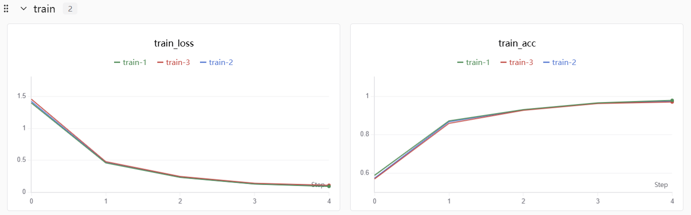
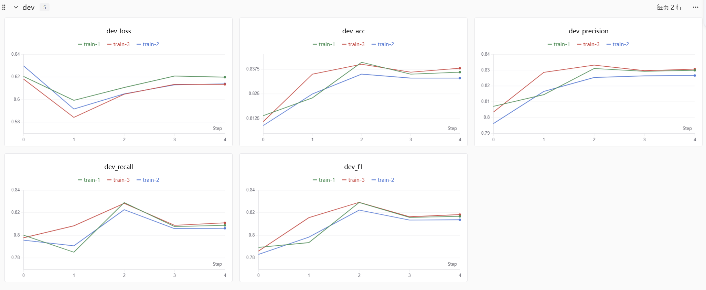
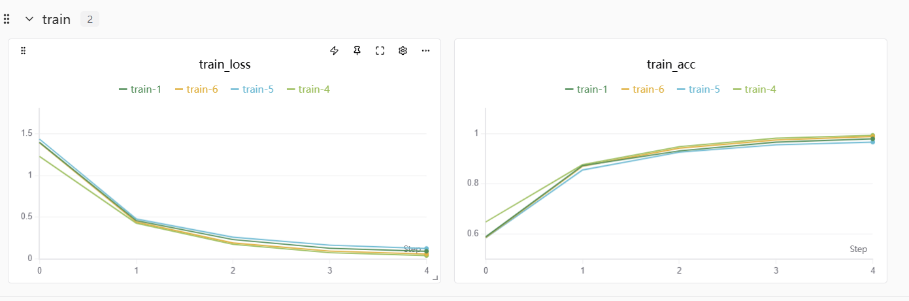
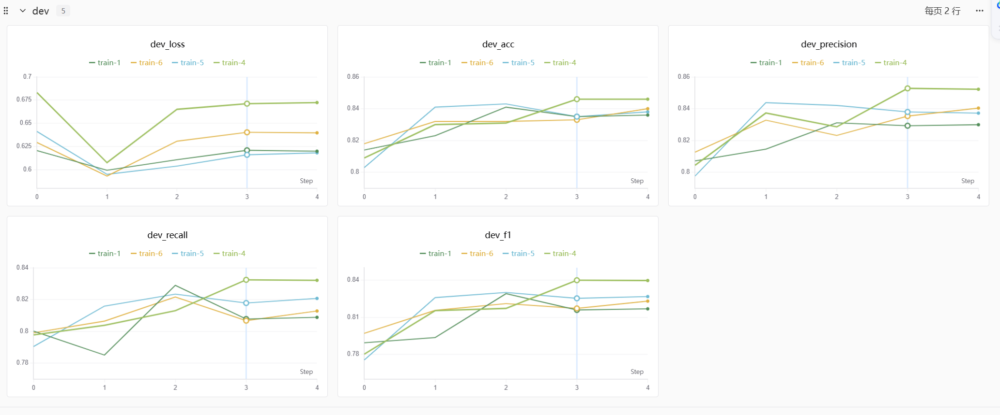
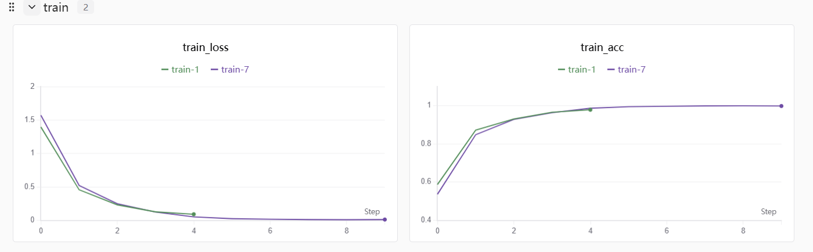
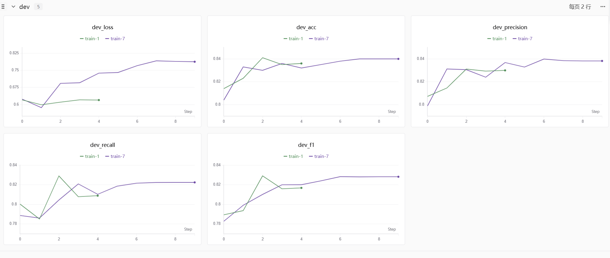
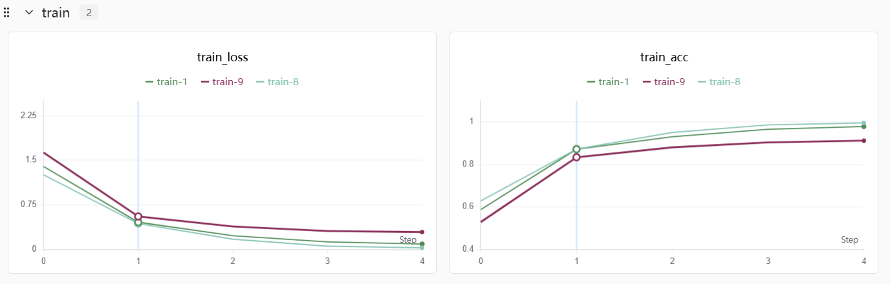
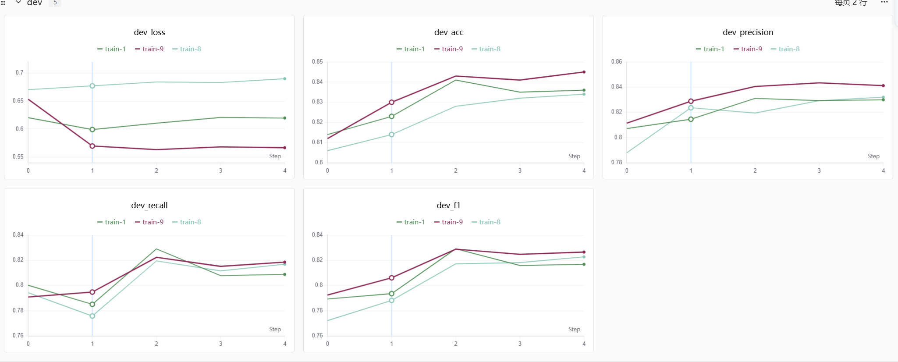

# ITREC 新生训练营demo1
该项目基于bert-base模型进行fine-tuning, 在原有模型的基础上添加分类头，以完成新闻头条文本分类的任务。<br>
具体数据集和demo说明参考仓库：**https://github.com/DMU-ITREC/itrec-nlp-newcomer-guide/tree/main**
## 项目文件
- \ datas \ 0.demo1文本分类 \ new_id_convert.json : 新闻id和对应新闻的对应关系，以及新闻id和id的对应关系
- \ config \ base.json : 模型基础配置文件
- datasets_clean.py : 数据预处理文件(清洗以及生成new_id_convert.json)
- datasets.py : 数据集文件
- environment.yml : conda环境文件
- evaluationMetrics.py : 模型指标文件
- model.py : 模型文件
- train.py : 模型训练文件
- utils.py : 通用工具文件
## 环境(Windows)
项目环境参考文件：environment.yml<br>
主要运行环境:PyTorch、Transformers、swanlab
## 快速运行
```项目目录
├── ITREC
    ├── datas
    ├   └── 0.demo1文本分类
    ├       └── new_id_convert.json
    └── Demo
        └── demo1
            └── configs
            ├   └── base.json
            ├   datasets_clean.py
            ├   datasets.py
            ├   environment.yml
            ├   evaluationMetrics.py
            ├   model.py
            ├   train.py
            └── utils.py
```
运行命令目录(命令均在ITREC路径下):
```
cd ~\ITREC
```
1.在终端输入
```powershell
swanlab login
``` 
登录 swanlab,并修改trian.py代码中的project和workspace
```python
# 初始化一个新的 swanlab 实验
swanlab.init(
    # 设置将记录此次实验的项目信息
    project="itrec-tc",
    workspace="iwills",
    # 跟踪超参数和实验元数据
    config={
        "adamW_bert_lr": self.config.train.adamW_bert_lr,
        "adamW_classifier_lr": self.config.train.adamW_classifier_lr,
        "epochs": self.epochs,
        "dropout" : self.config.model.dropout,
        "batch_size" : self.config.data.batch_size
    }
)
```
2.根据项目更改config.py的配置<br>
3.运行datasets_clean.py文件<br>
```
python Demo/demo1/datasets_clean.py
```
4.运行train.py文件
```
python Demo/demo1/train.py
```
## 新闻id 与 id的对应关系(new_id_convert.json)
```
{
  "new_id_label": {
    "100": "news_story",
    "101": "news_culture",
    "102": "news_entertainment",
    "103": "news_sports",
    "104": "news_finance",
    "106": "news_house",
    "107": "news_car",
    "108": "news_edu",
    "109": "news_tech",
    "110": "news_military",
    "112": "news_travel",
    "113": "news_world",
    "114": "stock",
    "115": "news_agriculture",
    "116": "news_game"
  },
  "new_id_convert": {
    "100": 0,
    "101": 1,
    "102": 2,
    "103": 3,
    "104": 4,
    "106": 5,
    "107": 6,
    "108": 7,
    "109": 8,
    "110": 9,
    "112": 10,
    "113": 11,
    "114": 12,
    "115": 13,
    "116": 14
  }
}
```

## 超参数不同下的指标对比
在swanlab上的训练数据展示url:https://swanlab.cn/@iwills/itrec-tc-new/v0/overview

| 序号 | 训练 | epochs | EarlyStopping | warmup—ratio | batch | dropout | bert-base-lr | classifier-lr |  best_dev_acc | test_loss | test_acc |
| :---: | :---: | :---: | :---: | :---: | :---: | :---: | :---: | :---: | :---: | :---: | :---: |
| 1 | train1 | 5 | 2 | 0.1 | 32 | 0.1 | $2 * 10^{-5}$ | $1 * 10^{-3}$ | 0.8410 | 0.6197 | **0.8440** |
| 2 | train2 | 5 | 2 | 0.1 | 32 | 0.2 | $2 * 10^{-5}$ | $1 * 10^{-3}$ | 0.8350 | 0.6261 | **0.8318** |
| 3 | train3 | 5 | 2 | 0.1 | 32 | 0.3 | $2 * 10^{-5}$ | $1 * 10^{-3}$ | 0.8400 | 0.6346 | **0.8346** |
| 4 | train4 | 5 | 2 | 0.1 | 16 | 0.1 | $2 * 10^{-5}$ | $1 * 10^{-3}$ | 0.8460 | 0.6941 | **0.8346** |
| 5 | train5 | 5 | 2 | 0.1 | 16 | 0.1 | $1 * 10^{-5}$ | $5 * 10^{-4}$ | 0.8430 | 0.6231 | **0.8308** |
| 6 | train6 | 5 | 2 | 0.1 | 64 | 0.1 | $4 * 10^{-5}$ | $2 * 10^{-3}$ | 0.8400 | 0.6744 | **0.8421** |
| 7 | train7 | 10 | 3 | 0.1 | 32 | 0.1 | $2 * 10^{-5}$ | $1 * 10^{-3}$ | 0.8400 | 0.8106 | **0.8430** |
| 8 | train8 | 5 | 2 | 0.1 | 32 | 0.1 | $5 * 10^{-5}$ | $1 * 10^{-3}$ | 0.8340 | 0.7311 | **0.8374** |
| 9 | train9 | 5 | 2 | 0.1 | 32 | 0.1 | $5 * 10^{-6}$ | $1 * 10^{-3}$ | 0.8450 | 0.5856 | **0.8336** |
以上的test_acc都是在每一套参数下最优的model上测试，以上有以下的对照组：
- **dropout(1、2、3，但仅仅针对分类头)**:在dropout分别为0.1，0.2，0.3的情况下，三种不同的配置，但各个曲线非常接近，说明dropout在这个范围内，对模型练收敛影响较小。验证集上，dropout=0.3的时候，最总的acc、precision、recall和f1参数略高，但与dropout=0.1的差距较小。各个模型在1-2个epoch后，训练损持续下降，而验证集的损失却开始回升，表现出一部分的过拟合。

- **batch和更新率（1、4，4、5 和 1、5、6）** : 分析数据，train4的batch_size降低，学习率不变，数据更新步数变大；因为batch_size降低，该batch的梯度计的方差可能会变大，并伴随有噪声，模型拟合train训练集更快；train5和train6的学习率都于batch_size同比例缩放，模型拟合过程的曲线都于base接近

- **epoch（1、7）** :train7与train1的差别是epochs和early stop，且因为epochs增加，warmup的步数也增加一倍。在epochs为0和1的时候，两个配置下的模型合数据接近，但从epochs为2时，train7的dev_loss开始逐渐大于train1，可能与train7的部分数据错误预测更加自信相关，导致loss偏大；在epochs4以后，train7模型不断过拟合train数据集，dev的loss不断增加，但acc增加的非常缓慢以至于最后不变

- **bast-base的lr（1, 8，9）**:train8和trian9在不同于train1的bert-base的学习率，train8的设置数值为5e-5,train9的设置数据为5e-6；可以根据数据观测较小的bert-base参数学习率，模型关于训练集的loss较大，acc较小，模型训练的更加温和。在本次实验中，较小的学习率使得模型过拟合迹象较轻，对于dev的泛化能较强
